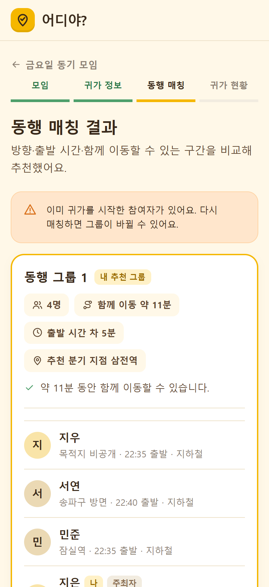
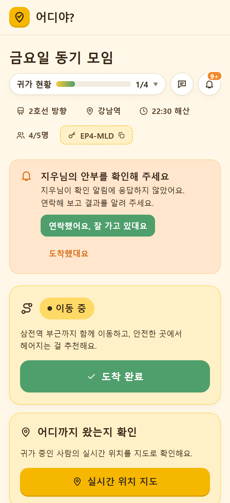
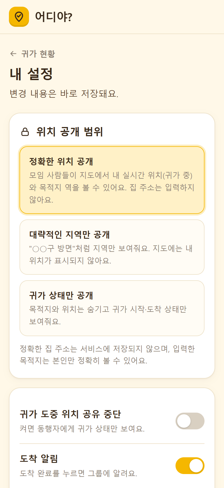
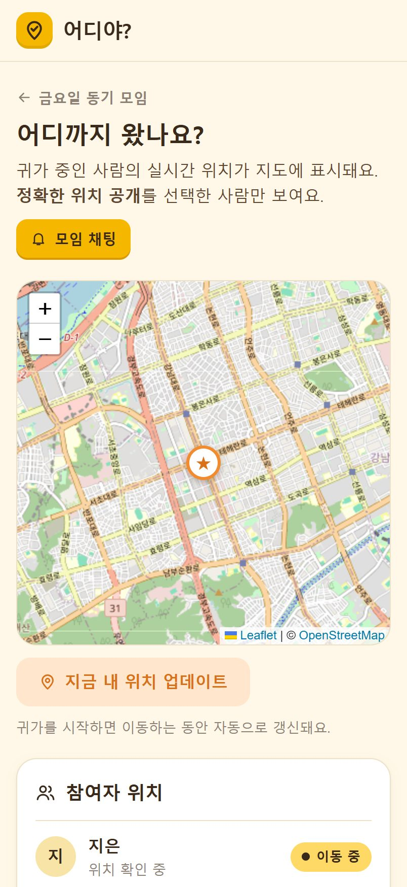

# 어디야? — 함께 가고, 무사히 도착하고.

모임이 끝난 뒤 **비슷한 방향으로 귀가하는 사람들을 연결**하고, **마지막 한 사람이 도착할 때까지** 귀가 과정을 함께 챙기는 안심귀가 서비스예요.

- 🔗 **체험하기**: https://adiya-app.vercel.app (가입 없이 익명으로 바로 시작해요)
- 📱 아이폰 크기(모바일) 기준으로 만든 웹앱이에요.

<table>
  <tr>
    <td></td>
    <td></td>
    <td></td>
    <td></td>
    <td></td>
  </tr>
  <tr align="center">
    <td>첫 화면</td><td>동행 매칭</td><td>귀가 현황·안부 확인</td><td>공개 범위 설정</td><td>실시간 지도</td>
  </tr>
</table>

## 해결하려는 문제

늦은 밤 모임이 끝나면 이런 일이 생겨요.

1. 귀가 방향이 비슷한 사람이 있어도 서로 몰라서 **각자 따로 돌아가요.**
2. 일행이 하나둘 내리다 보면 **마지막엔 혼자 남는 사람**이 생겨요.
3. 위치 공유 앱은 "어디 있는지"만 알려줄 뿐, **동행을 만들어주진 않아요.**
4. 집 주소와 실시간 위치를 모두에게 공개하는 건 **부담스러워요.**

어디야?는 **연결(동행 매칭) → 확인(마지막 한 사람까지) → 보호(공개 범위는 내가 정함)** 순서로 이 문제를 풀어요.

## 주요 기능

| 구분 | 기능 |
|---|---|
| 연결 | 초대 코드로 모임 만들기·참여 / **모집 중인 모임** 공개·목록에서 바로 참여 / **주변에서 같은 방향으로 갈 사람 찾기**(반경 500m·1km·3km, 제안을 수락해야 모임 생성) |
| 매칭 | 방향·거리·시간·함께 이동 구간을 비교해 그룹 추천, **왜 묶였는지 문장으로 설명**, 안전하게 헤어질 **분기 지점** 추천 |
| 확인 | 그룹별 귀가 현황과 진행 막대, "마지막 미도착" 표시, 모두 도착하면 모임 끝내기 |
| 대응 | **단계별 안부 확인**(본인 → 지정한 사람/주최자), **막차 위험 알림**, 목적지 300m 안 **자동 도착 감지** |
| 소통 | **실시간 위치 지도**(Leaflet), 모임 채팅, 모임 알림 |
| 보호 | **위치 공개 3단계**(정확한 위치 / 대략적인 지역 / 귀가 상태만), 집 주소는 입력·저장하지 않음 |

### 단계별 안부 확인

도착이 늦은 것만으로 위험하다고 단정하지 않아요.

1. 예상 도착 시간이 지나면 **본인에게** 확인 알림을 보내요.
2. 5분 안에 응답이 없으면 **지정한 안부 대상(기본: 주최자)** 에게 확인을 요청해요.
3. 응답에 따라 상태를 갱신해요. 주최자가 직접 "안부 확인 요청"을 보낼 수도 있어요.

앱은 15초마다 자기 상태(예상 도착 지연·막차 위험)를 자동으로 점검해요.

## AI 동행 매칭 엔진

`src/lib/matching.ts` — 두 사람씩 비교한 점수를 합산해 100점 만점으로 계산해요.

| 기준 | 배점 | 설명 |
|---|---|---|
| 귀가 방향 유사도 | 40 | 출발역→목적지 **방위각** 차이 |
| 목적지 간 거리 | 25 | 두 목적지의 **Haversine 거리** |
| 출발 시간 차이 | 20 | 출발 예정 시각의 차이 |
| 함께 이동할 수 있는 구간 | 15 | 공통 진행 방향의 이동 시간(분), 교통수단 보정 포함 |

- **교통수단 보정**: 같은 수단 1.0 · 지하철↔버스 0.9 · 그 외 0.3
- **그룹 기준**: 서로 45점 이상, 그룹 평균 60점 이상, 그룹당 최대 5명, 2인 모임은 자동으로 한 팀
- **설명 생성**: 점수 대신 "귀가 방향이 유사합니다", "약 11분 동안 함께 이동할 수 있습니다" 같은 이유 문장을 보여줘요.
- **분기 지점**: 공통 진행 방향으로 나아간 지점에서 가장 가까운 역을 추천해요.

> **솔직한 구현 수준** — 현재 "AI"는 **규칙 기반 스코어링**이에요. LLM·머신러닝 모델은 사용하지 않아요. 결과를 설명할 수 있고 같은 입력에 같은 결과가 나오는 것을 우선했어요.

## 시연 범위와 한계

실제로 동작하는 것과 시연 기준인 것을 구분해 두었어요.

| 구분 | 내용 |
|---|---|
| ✅ 실제 동작 | 모임 생성·참여, 모집 공개, 주변 찾기, 매칭, 실시간 위치 지도, 채팅, 단계별 안부 확인, 자동 도착 감지, 위치 공개 설정 |
| 🧪 시연 기준 | **막차 시간은 고정값**(지하철 00:20, 버스 23:40), 이동 시간은 거리 기반 추정치 |
| ⏭ 아직 없음 | 푸시 알림(모든 알림은 앱 안에서만 표시), 대중교통 API 연동, LLM/ML 기반 기능 |

## 기술 스택과 구조

```
 모바일 웹앱 (Vercel)                         Supabase
 React 19 · TypeScript · Vite   <──────────>  익명 로그인(Auth)
 React Router(HashRouter)        Realtime      Postgres + 행 단위 보안(RLS) · 9개 테이블
 Leaflet 지도 · 브라우저 GPS     RPC           SQL 함수(RPC) 24개
```

- **Auth**: 익명 로그인 — 가입 없이 바로 시작해요.
- **Realtime**: 모임 현황·채팅·주변 초대 변경을 구독해 즉시 반영해요.
- **보안(RLS)**: 모든 테이블에 행 단위 보안을 적용했어요. 위치 공개 범위는 화면이 아니라 **DB 정책으로 강제**해요. 다른 참여자의 위치는 "정확한 위치 공개"를 고르고 공유를 멈추지 않은 사람만 내려가요.
- **주변 찾기**: 서로에게는 닉네임과 대략적인 거리만 보이고, 수락해야 모임이 만들어져요.
- **데이터**: 도시철도 **36개 노선·939개 역**(OpenStreetMap contributors, ODbL). 지도 API 없이 좌표로 거리·방향을 계산해요.

## 폴더 구조

```
src/
  pages/       Landing · Create · Created · Join · Register · Match · Dashboard
               Settings · Meetings(모집 중인 모임) · Nearby(주변 찾기) · Live(지도) · Chat
  components/  Layout · Icon · Toast · StationPicker · TimeField · 공용 UI
  hooks/       useMeeting(모임 로딩·실시간 구독·자동 점검·액션) · useGeolocation
  lib/         api(Supabase) · matching(매칭 엔진) · geo · stations · session
  styles/      app.css (디자인 시스템)
supabase/      migrations(스키마·RLS·RPC) · config.toml
scripts/       seed-demo-meetings.mjs (시연용 모집 모임 만들기)
prototype/     초기 정적 프로토타입 (참고용, 현재 앱과 일부 다름)
docs/          README 스크린샷
```

## 시작하기

```bash
npm install
cp .env.example .env     # Supabase URL / publishable 키 입력
npm run dev              # React 앱 개발 서버
npm run build            # 타입 검사 + 프로덕션 빌드
npm run typecheck        # 타입 검사만
npm run dev:proto        # 정적 프로토타입(prototype/) 서버
```

### Supabase 설정

1. `.env.example`을 `.env`로 복사해 Supabase **URL**과 **publishable(anon) 키**를 넣어요. `.env`는 git에 올라가지 않아요. secret / service_role 키는 프론트에 넣지 마세요.
2. Supabase 대시보드 → Authentication → Sign In / Providers에서 **Anonymous sign-ins**를 켜요.
3. `supabase/migrations/`의 SQL을 파일 이름 순서대로 적용해요.
4. (선택) 시연용 모집 모임이 필요하면 `node scripts/seed-demo-meetings.mjs`를 실행해요. 모집 목록은 개설 후 12시간이 지나면 사라지므로 필요하면 다시 실행하세요.

## 데이터 출처

- 역 데이터 © OpenStreetMap contributors (ODbL)
- 지도 © OpenStreetMap, Leaflet
